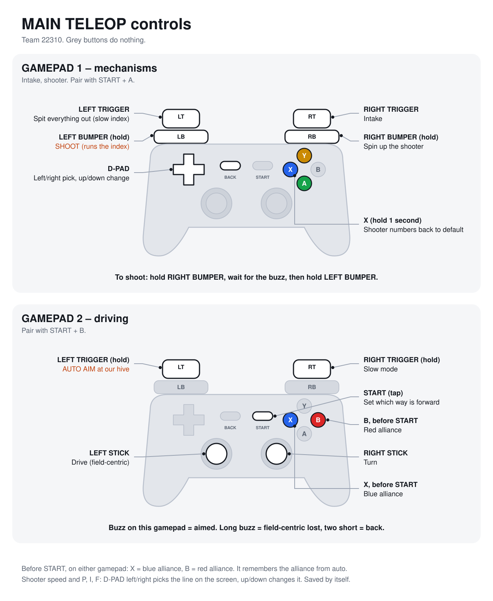

# Robot code notes

For the comp on Saturday Nov 28. Read "Before the comp" at least once.

Everything here builds and passes the desktop tests and simulator. The auto aim, the one-button shot speed and the new flywheel control have **not been on the real robot yet**. Test them Thursday / Friday.

## Controls

| Gamepad 1 (mechanisms) | Does |
|---|---|
| RIGHT TRIGGER | Intake |
| LEFT TRIGGER | Spit everything out (wins over everything else) |
| RIGHT BUMPER (hold) | Spin up the shooter to the right speed |
| LEFT BUMPER (hold) | Shoot (feeds the pollen in) |
| Y | Backup speed high / low, only used when the camera can't see the hive |
| BACK | Open / close shot setup |

| Gamepad 2 (driving) | Does |
|---|---|
| LEFT STICK | Drive (field-centric) |
| RIGHT STICK | Turn |
| LEFT TRIGGER (hold) | Auto aim at our hive |
| RIGHT TRIGGER (hold) | Slow mode |
| START (tap) | Make the way the robot faces "forward" |

Before START, on either gamepad: **X = blue alliance, B = red alliance**. After an auto it already knows.

**To shoot:** hold RIGHT BUMPER, wait for gamepad 1 to buzz, hold LEFT BUMPER. Driver holds LEFT TRIGGER to aim; gamepad 2 buzzes when aimed.

## Shot setup (do this once, about 5 minutes)

The shooter picks its speed from how far the hive is. It has to learn that first.

1. Put the robot where you normally shoot. The camera has to see our hive.
2. Gamepad 1: press BACK. The Driver Station shows SHOT SETUP and the hive distance.
3. Hold RIGHT BUMPER and shoot. D-PAD up / down changes the speed by 25 until it scores.
4. Press A. That speed is saved for that distance.
5. Do it again at 1 or 2 other distances (one close, one far).
6. Press BACK to finish.

- Saved shots stay on the Control Hub, even after installing new code.
- X deletes the saved shot nearest to where you are.
- Until something is saved, RIGHT BUMPER uses the Y preset (1500 high / 900 low), like before.
- Between two saved distances it picks a speed in between.
- If the Driver Station never shows a hive distance, the Limelight pipeline needs "Full 3D" turned on for AprilTags. Aiming still works without it.

## Auto aim

- Hold LEFT TRIGGER on gamepad 2. The robot turns to face our hive and holds it. You can still drive around while it aims.
- The camera finds the hive, then the Pinpoint gyro holds the direction. So it stays aimed even if the tag blinks out for a second.
- Red looks for tags 30-37, blue for 38-45. Wrong alliance = it never finds the hive.
- If the camera can't see the hive, the right stick still turns the robot.
- It uses Limelight pipeline 0 and assumes the camera points the same way the shooter shoots.

If it's wrong on the real robot, change one number at the top of `FinalTeleOp/FinalMechanisms/HiveAim.java`:

| Problem | Change |
|---|---|
| Turns AWAY from the hive | `TX_SIGN` to -1 |
| Aims a bit left or right every time | `AIM_OFFSET_DEGREES` (+ aims further right) |
| Wobbles back and forth | lower `KP` (try 0.7) |
| Too slow / stops short | raise `KP` (try 1.3) |

## Autos

| Auto | What it does |
|---|---|
| Red Alliance Strong | Shoots 4 preloads, intakes the garden, drives across, shoots again, parks |
| Blue Alliance Strong | Same thing, mirrored |
| RedAllianceWeak | Drives to the shooting spot, shoots 4 preloads, parks |
| BlueAllianceWeak | Same thing, mirrored |

- Every auto parks by 24 s no matter what, and selects MAIN TELEOP after.
- Auto shoots at `HIGH_VELOCITY = 2300` (top of `FlywheelAuto.java`). There is no camera in auto, so this number has to be right for the auto shooting spots. Tune it on a field.
- Blue is red rotated 180 degrees. Change red and blue changes too. Blue has never been on a field.
- Flower pickup is in the code but turned off.

## Before the comp

1. **Flywheel direction.** Wheels off the ground, hold RIGHT BUMPER. They should spin the shooting way. If not, change `FORWARD` in `FlywheelTunerPIDF.java` and `FlywheelAuto.java`.
2. **Flywheels smooth?** They should spin up in under a second and hold steady. If they hunt up and down, lower `DEFAULT_P` in `FlywheelControl.java` (try 0.6).
3. **Auto aim.** Hold LEFT TRIGGER with the hive in view. See the table above if it's wrong.
4. **Shot setup.** Save 2 or 3 shots (see above).
5. **Auto start pose.** After INIT the Driver Station shows where the robot should be. It has to match.
   - Red Strong: x 56, y 8, heading 270
   - Blue Strong: x 88, y 136, heading 90
   - Red Weak: x 56, y 8, heading 90
   - Blue Weak: x 88, y 136, heading 270
6. **Auto shot speed.** Run each auto you plan to use and fix `HIGH_VELOCITY`.
7. **Pinpoint cable test.** INIT an auto, pull the Pinpoint cable for half a second, plug it back. It should say "Pinpoint restarted".
8. **After auto.** At teleop INIT, "forward" is whatever way the robot is facing. Driver 2: point the robot away from you and tap START.
9. Fresh battery every match. Low battery = slower flywheels and shorter shots.

## What the Driver Station is telling you

| Message | Means |
|---|---|
| A HUB LOST POWER | Battery / power cable problem. The code recovered, but check the battery, switch and XT30 cables |
| INTAKE OFF / FLYWHEEL OFF / AUTO AIM OFF | That device is missing from the robot config. Everything else still works |
| ROBOT-CENTRIC | No Pinpoint heading. Driving still works, just not field-centric. Auto aim needs the Pinpoint |
| Pinpoint restarted - face forward, tap START | Pinpoint cable blipped. Point the robot away from you and tap START |
| A FLYWHEEL READS 0 | Flywheel encoder cable or a jam |
| Drive power limit under 100% | Battery is low, drive power eased off so the robot doesn't brown out |
| camera not answering | Limelight unplugged or still starting (takes about 20 s after power on) |

## Where to change numbers

| What | Where |
|---|---|
| Auto speeds, timings, positions | top of `RedAllianceStrong.java` / `RedAllianceWeak.java` |
| Auto flywheel speed | top of `FlywheelAuto.java` |
| Teleop backup speeds (1500 / 900) | top of `FlywheelTunerPIDF.java` |
| Flywheel smoothness | `DEFAULT_P` in `FlywheelControl.java` |
| Auto aim | top of `HiveAim.java` |
| How the sticks feel, slow mode speed | top of `MecanumDriveFinal.java` |
| How long auto feeds a volley | `FEED_MS` in `Volley.java` |
| Intake / index power | top of `IndexIntake.java` |
| Pedro tuning | `FinalAuto/pedro/PedroTuning/Constants.java` |

If something feels off, change the number instead of reverting the whole file.

## What changed

**Nov 25**
- Auto aim built into MAIN TELEOP (gamepad 2 LEFT TRIGGER).
- One button shooter: RIGHT BUMPER spins to the speed for the hive distance. Shot setup saves speeds on the robot.
- Slow mode on gamepad 2 RIGHT TRIGGER.
- Alliance picked at INIT (X / B), remembered from auto.
- Flywheels are judged "at speed" on their average, and the two wheels are kept matched.
- Auto still drives and parks if the intake or flywheel is missing from the config.
- Only MAIN TELEOP is left in the "TeamCode" group on the Driver Station. Test and backup opmodes moved to "Test".
- P / F tuning on the gamepad is gone. It isn't needed with the new flywheel control.

**Nov 24**
- "TargetPositionNotSetException" crash fixed. It was a hub losing power for a moment when driving and shooting together. Motors now set themselves up again and carry on.
- Stuttery flywheels fixed. New `FlywheelControl.java` runs both wheels smoothly from our code. Auto feeds a volley in one push.
- FTCLib removed from `build.gradle` (unused, duplicate of SolversLib).
- Auto: stops if the Pinpoint drops out or restarts, only shoots when facing the target, recovers from a Pinpoint glitch during INIT.
- Teleop still drives if a mechanism or the Pinpoint is missing.
- Heading reset moved to releasing START so pairing a gamepad can't trigger it.

**Nov 23**
- New autos: Red / Blue Strong and Weak on a shared `AutoBase`.
- Smoother teleop drive, low battery limiter, field-centric with the Pinpoint.
- Battery drain and 11 V to 4 V drop fixed (drive motors were in the wrong run mode).
- Colour sensor red / blue swap fixed. Pedro "Pinpoint not ready" fixed.
