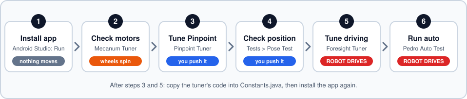
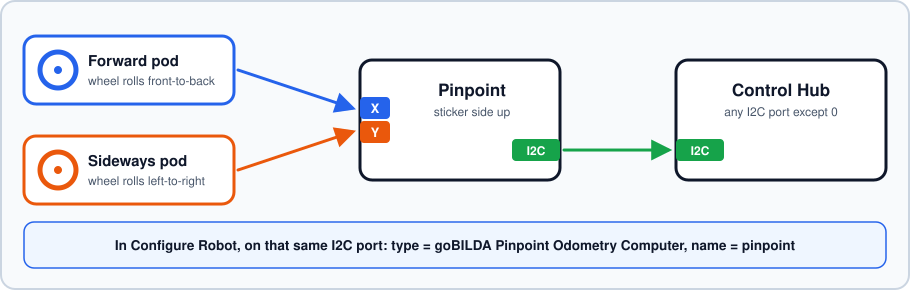
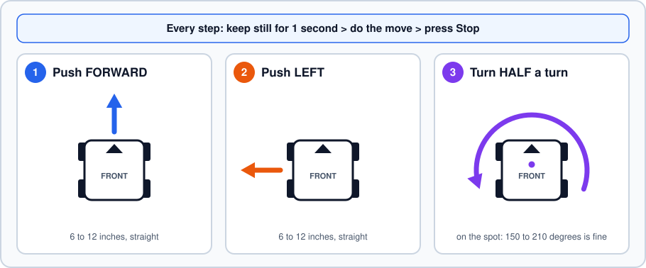
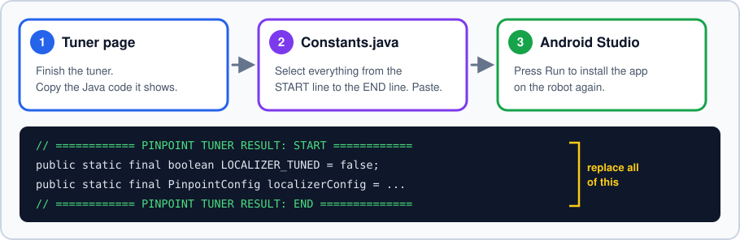
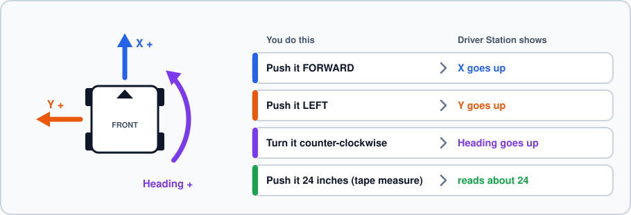
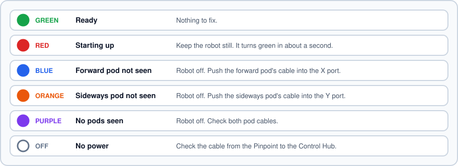

# Pedro setup

Do the six steps in order. Each one has a picture.

**Opening the tuners:** connect your laptop to the robot's Wi-Fi, then open **http://192.168.43.1:10158**.
Keep the Driver Station in your hand so you can press Stop.

## Before you start: wiring

## 1. Install the app

In Android Studio press **Run** with the Control Hub connected. Pushing to GitHub does **not** update the robot.

## 2. Check motors

Lift the robot so the **wheels are off the floor**. Open **Mecanum Tuner** and answer its questions. Each wheel spins by itself.

## 3. Tune Pinpoint

Put the robot **on the floor**. Open **Pinpoint Tuner**. You push the robot by hand; no motor moves.

The Driver Station shows live numbers while you push. `Bad reads skipped` going up slowly is normal.

When the tuner finishes, save the result:

## 4. Check position

Open **Tests**, choose **Pose Test**. Push the robot by hand and watch the Driver Station.

Anything wrong here? Run step 3 again before going on.

## 5. Tune driving

> **The robot drives by itself in this step, sometimes at full power.** Clear the floor. Be ready to press Stop.

Open **Foresight Tuner** and follow it. Save the result the same way as step 3, but over the **FORESIGHT TUNER RESULT** block.

## 6. Run auto

Open **Tests** and try **Line Test** with a short distance first. Then run **22310 Pedro Auto Test** from the Driver Station.

## If something goes wrong

Look at the light on the Pinpoint first.

| The screen says | Do this |
| --- | --- |
| No goBILDA Pinpoint called "pinpoint" | In **Configure Robot**, add a *goBILDA Pinpoint Odometry Computer* named `pinpoint`. Save and activate. |
| Gets no answer from the Pinpoint | In **Configure Robot**, the I2C port number must match the port the cable is in. |
| Still calibrating | Hands off the robot while a step starts. |
| Travel was less than one inch | Push further (6 to 12 inches). Check the pod wheel touches the floor. |
| The other encoder moved | The two pod cables are swapped, or you pushed the wrong way. |
| You turned … degrees | Turn about half a turn, then press Stop. |
| Pods came out bigger than the robot | The robot slid while turning. Spin it on the spot. |
| Pinpoint is not tuned yet | Finish step 3 and install the app again. |
| Driving is not tuned yet | Finish step 5 and install the app again. |
| Web page won't open | Laptop must be on the robot's Wi-Fi. Use `http://192.168.43.1:10158`. |

**Always turn the robot off before unplugging a cable.**
