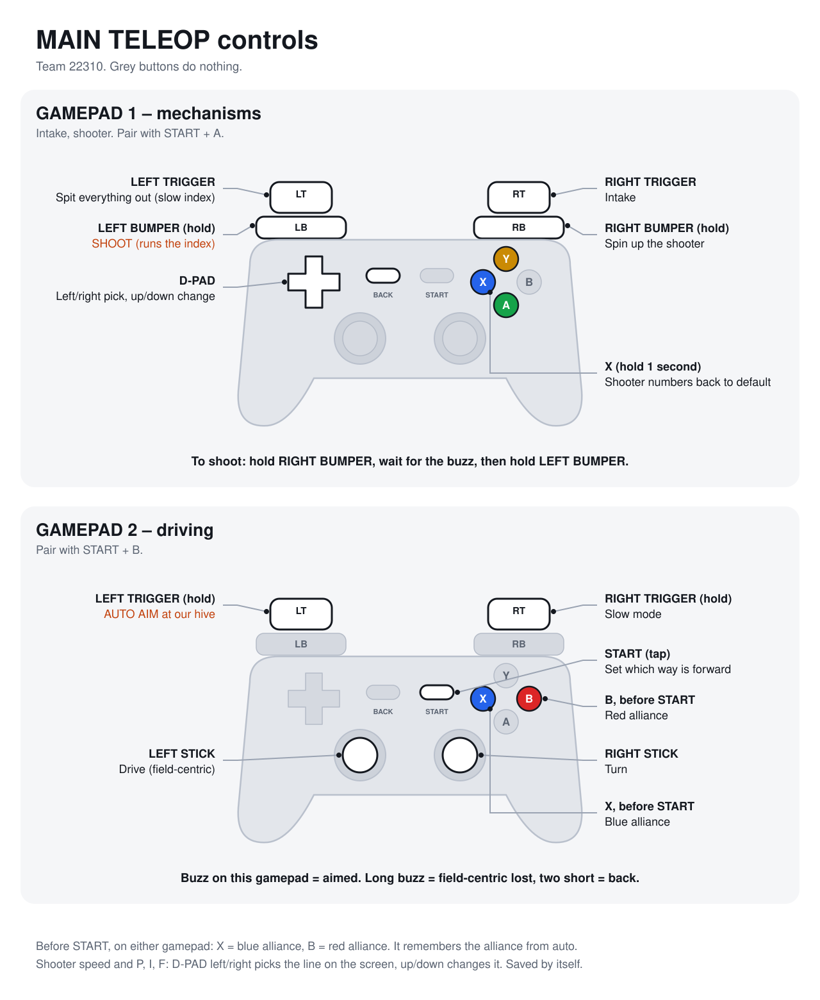

# Team 22310 robot code

Everything our robot runs in a match is in this folder. This page says how to drive it, how the code is laid out, what to check before a comp, and what changed.

It builds and passes the desktop tests and the simulator. **The camera aim, the one-button shot speed and the new flywheel control have not been proven on the real robot yet.** Do the checklist in "Before a comp".

## Controls



| Gamepad 1 (mechanisms) | Does |
|---|---|
| RIGHT TRIGGER | Intake |
| LEFT TRIGGER | Spit everything out (beats everything else). The index runs slowly so pollen don't get thrown |
| RIGHT BUMPER (hold) | Spin up the shooter to the right speed |
| LEFT BUMPER (hold) | Shoot. The index waits for the flywheels by itself |
| Y | Backup speed high / low, only used when the camera can't see the hive |
| BACK | Open / close shot setup |

| Gamepad 2 (driving) | Does |
|---|---|
| LEFT STICK | Drive (field-centric) |
| RIGHT STICK | Turn |
| LEFT TRIGGER (hold) | Auto aim at our hive |
| RIGHT TRIGGER (hold) | Slow mode |
| START (tap) | Make the way the robot faces "forward" |

Before START, on either gamepad: **X = blue alliance, B = red alliance**. After an auto it already knows.

**To shoot:** hold RIGHT BUMPER and LEFT BUMPER. The robot does the timing: the index only feeds when the flywheels are at speed, so you can hold both from the start. Gamepad 1 buzzes when the wheels are ready, gamepad 2 buzzes when the aim is locked.

## Shot setup (once, about 5 minutes)

The shooter picks its speed from how far away the hive is. It has to be taught first.

1. Put the robot where you normally shoot. The camera has to see our hive.
2. Gamepad 1: press BACK. The Driver Station shows SHOT SETUP and the hive distance.
3. Hold both bumpers and shoot. D-PAD up / down changes the speed by 25 until it scores.
4. Press A. That speed is saved for that distance.
5. Repeat at one or two other distances (one close, one far).
6. Press BACK.

- Saved shots live on the Control Hub and survive new code installs.
- X deletes the saved shot nearest to where you are.
- Between two saved distances it uses a speed in between.
- Nothing saved yet? RIGHT BUMPER uses the Y preset (1500 high / 900 low).
- Autonomous uses the same saved shots when its camera can see the hive.
- No hive distance on the screen? Turn on "Full 3D" for AprilTags in the Limelight pipeline. Aiming works without it; only the distance needs it.

## Auto aim

Hold LEFT TRIGGER on gamepad 2. The robot turns to face our hive and stays locked on, and you can keep driving with the left stick.

How it works: the camera only says *where* the hive is. The turning is done on the Pinpoint gyro, which is read every loop with no delay. That is why it is quick and why it stays locked when the tag blinks out for a moment.

- Red aims at tags 30-37, blue at 38-45. Wrong alliance = it never finds the hive.
- The Driver Station line "AIM" says what it sees, including which tag numbers are in view.
- It uses Limelight pipeline 0 and assumes the camera looks the way the shooter shoots.

If it is wrong on the real robot, it is one number at the top of `Shared/HiveAim.java`:

| Problem | Change |
|---|---|
| Turns AWAY from the hive | `TX_SIGN` to -1 |
| Always a bit left or right | `AIM_OFFSET_DEGREES` (+ aims further right) |
| Wobbles back and forth | lower `KP` and `KD` together (try 1.8 and 0.22) |
| Slow, or stops short | raise both (try 3.0 and 0.36). Keep KD about 0.12 x KP |
| AprilTag pipeline is not slot 0 | `PIPELINE` |

## Autos

| Auto | What it does |
|---|---|
| Red Alliance Strong | Shoots 4 preloads, intakes the garden, drives across, shoots 4 more, parks |
| Blue Alliance Strong | Same, mirrored |
| RedAllianceWeak | Drives to the shooting spot, shoots 4 preloads, parks |
| BlueAllianceWeak | Same, mirrored |

- **Every shot is aimed with the camera** if it can see the hive: the robot turns to the tags before feeding. If it can't see them it shoots on the heading from the route. A camera reading that asks for more than 25 degrees is ignored as a bad read.
- Shot speed in auto: the saved shot for the measured distance, otherwise `HIGH_VELOCITY` (2300) in `FlywheelAuto.java`.
- Every auto is parked by 24 s no matter what, and selects MAIN TELEOP afterwards.
- A missing intake, flywheel or camera does not stop the auto. It still drives and parks.
- Blue is red turned half a turn. Change red and blue changes too. Blue has never been on a field.
- Flower pickup is written but switched off.

## Battery protection

The battery used to drop from 11 V to 4 V and once reset a hub mid-match. Now:

- `Shared/Battery.java` watches the voltage for the whole robot.
- Low voltage caps the drive power and slows how fast any motor may ramp up.
- Drive, intake and index all ramp up over a fraction of a second instead of jumping to full.
- The flywheels limit their own current while spinning up (about 10 A for both, not 17).
- If a hub does restart, every motor sets itself up again and carries on. The Driver Station shows "A HUB LOST POWER".

Code can only soften it. A worn battery, a loose XT30 or a weak power switch still has to be fixed with a wrench.

## How the code is laid out

```
teamcode/
  Shared/               used by BOTH teleop and auto, so they can never disagree
    Battery             voltage watch + power limits
    FlywheelControl     runs the shooter wheels at a speed, says when they are ready
    IntakeAndIndex      intake roller + index belt, directions and speeds in one place
    HiveAim             Limelight -> which way to face, and how far the hive is
    ShotTable           the saved "distance -> speed" shots
    HubReset            recovering when a hub loses power

  FinalTeleOp/
    MainTeleOp          the match teleop: wires gamepads to mechanisms
    FinalMechanisms/
      MecanumDriveFinal   field-centric drive
      Shooter             gamepad 1 shooter buttons + shot setup
      IndexIntake         gamepad 1 intake / index buttons
    RobotSensors/         test OpModes (camera, colour sensor, turret)

  FinalAuto/
    AutoBase            what all four autos share (park deadline, clean-up, blue mirroring)
    RedAllianceStrong, RedAllianceWeak      the routes (blue ones are one line each)
    FinalMechanismsAuto/
      MecanumDriveAuto    Pedro drive as commands that can't hang, plus camera aim
      Volley              one volley: aim, spin up, feed, stop
      FlywheelAuto, IndexIntakeAuto    the shared mechanisms as auto commands
    pedro/              Pedro Pathing config and tuners (see pedro/PedroTuning/README.md)

  SavedBackupCode/      old code, kept for reference
```

Rule of thumb: a motor direction, a power or a speed lives in `Shared/`. Buttons live in `FinalTeleOp/`. Routes live in `FinalAuto/`.

## Before a comp

1. **Flywheel direction.** Wheels off the ground, hold RIGHT BUMPER. If they spin the wrong way, flip `DIRECTION` in `Shared/FlywheelControl.java` (one line, fixes teleop and auto).
2. **Flywheels smooth?** Under a second to speed, then steady. If they hunt, lower `DEFAULT_P` in `FlywheelControl.java` (try 0.6).
3. **Auto aim.** LEFT TRIGGER with the hive in view. Table above if it is wrong.
4. **Shot setup.** Save 2 or 3 shots.
5. **Outtake.** LEFT TRIGGER: the index should hand pollen back gently. Speed is `INDEX_OUTTAKE_POWER` in `Shared/IntakeAndIndex.java` (0.25).
6. **Auto start pose.** After INIT the Driver Station shows where the robot should be. It has to match.
   - Red Strong: x 56, y 8, heading 270
   - Blue Strong: x 88, y 136, heading 90
   - Red Weak: x 56, y 8, heading 90
   - Blue Weak: x 88, y 136, heading 270
7. **Run each auto you will use.** Watch the "Last aim" line: it says whether the camera aimed the shot.
8. **Pinpoint cable test.** INIT an auto, pull the Pinpoint cable for half a second, plug it back. It should say "Pinpoint restarted".
9. **After auto.** At teleop INIT, "forward" is whichever way the robot faces. Driver 2: point it away from you and tap START.
10. Fresh battery every match.

## What the Driver Station is telling you

| Message | Means |
|---|---|
| A HUB LOST POWER | Battery or power cable problem. The code recovered; check battery, switch, XT30 cables |
| INTAKE OFF / FLYWHEEL OFF / AUTO AIM OFF | That device is missing from the robot config. Everything else still works |
| ROBOT-CENTRIC | No Pinpoint heading. Driving works, auto aim does not |
| Pinpoint restarted - face forward, tap START | Pinpoint cable blipped. Point the robot away from you and tap START |
| Index is waiting for the flywheels | Normal while shooting: the next pollen goes when the wheels are back at speed |
| A FLYWHEEL READS 0 | Flywheel encoder cable or a jam |
| Drive power limit under 100% | Battery low; power eased off so the robot doesn't brown out |
| AIM: only sees tags ... | The camera sees tags, but not our hive's. Wrong alliance, or facing the wrong hive |
| camera not answering | Limelight unplugged or still starting (about 20 s after power on) |

## Where to change numbers

| What | Where |
|---|---|
| Auto routes, speeds, timings | top of `RedAllianceStrong.java` / `RedAllianceWeak.java` |
| Auto flywheel speed | top of `FlywheelAuto.java` |
| Teleop backup speeds (1500 / 900) | top of `Shooter.java` |
| Flywheel direction, smoothness, "ready" tolerance | top of `Shared/FlywheelControl.java` |
| Intake / index / outtake power | top of `Shared/IntakeAndIndex.java` |
| Auto aim | top of `Shared/HiveAim.java` |
| Battery limits | top of `Shared/Battery.java` |
| Stick feel, slow mode speed | top of `MecanumDriveFinal.java` |
| How long auto feeds a volley | `FEED_MS` in `Volley.java` |
| Pedro tuning | `FinalAuto/pedro/PedroTuning/Constants.java` |

Change the number instead of reverting a whole file.

## How it was tested

No robot was available, so everything was checked on a laptop:

- desktop tests with fake motors, gamepads, Pinpoint and battery (drive, flywheels, feed timing, shot setup, hub restarts, the whole teleop with devices missing)
- a motor and battery model for the flywheels
- a turn simulation for the auto aim (54 different robots: fast, slow, sticky, with camera delay)
- the four real auto routines run in a field simulator through ten scenarios (blocked by a wall, dead flywheel, stuck robot, ...). All end parked with everything off.

That finds logic bugs. It cannot find a backwards motor, a wrong camera angle or a number that needs tuning. That is what the checklist is for.

## What changed

**Nov 25 (revamp)**
- New `Shared/` folder: one copy of the battery guard, flywheel control, intake/index, camera aim and shot table, used by teleop and auto.
- Autonomous aims every shot with the Limelight and uses the saved shot speeds.
- Auto aim is about 30% quicker to lock and no longer overshoots when there is delay in the loop.
- Consistent shots: the index only feeds when the flywheels are at speed, in teleop and auto.
- The index runs slowly when outtaking (0.25 instead of 0.45).
- One battery guard for the whole robot; intake and index now ramp up too.
- Diagonal driving no longer bends for the first tenth of a second.
- Flywheel direction is defined once. `FlywheelTunerPIDF` is now `Shooter` (it stopped being a PIDF tuner).
- Every file has comments that say why, not just what.
- This readme replaces CHANGES.md.

**Nov 25 (earlier)**
- Auto aim in MAIN TELEOP, one-button shooter speed with shot setup, slow mode, alliance picked at INIT.
- Only MAIN TELEOP left in the "TeamCode" group on the Driver Station.

**Nov 24**
- "TargetPositionNotSetException" crash fixed (a hub losing power for a moment).
- Stuttery flywheels fixed: our own flywheel control instead of the hub's.
- FTCLib removed (unused duplicate of SolversLib).
- Auto stops if the Pinpoint drops out or restarts, and recovers from a glitch during INIT.
- Teleop still drives if a mechanism or the Pinpoint is missing.

**Nov 23**
- New autos: Red / Blue, Strong / Weak, on a shared `AutoBase`.
- Smoother teleop drive, low battery limiter, field-centric with the Pinpoint.
- Battery drain and the 11 V to 4 V drop fixed (drive motors were in the wrong run mode).
- Colour sensor red / blue swap fixed. Pedro "Pinpoint not ready" fixed.
